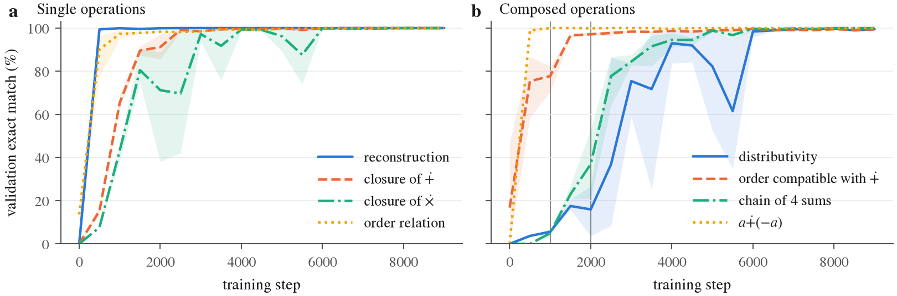
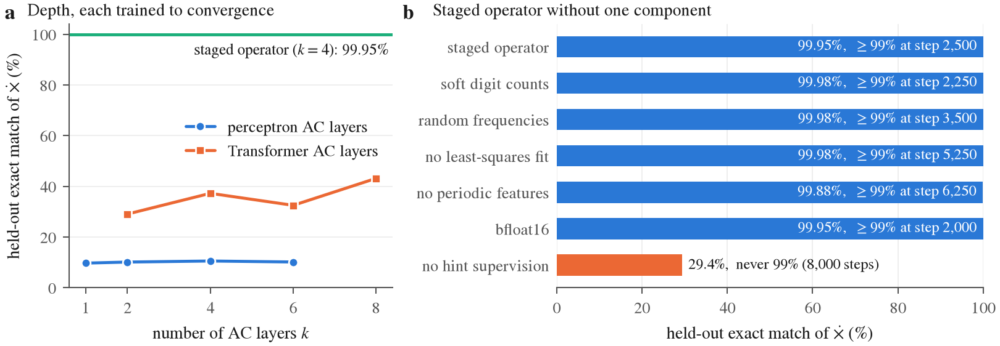
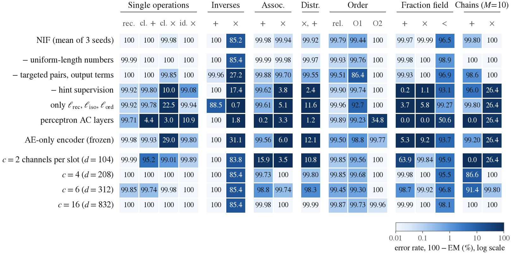
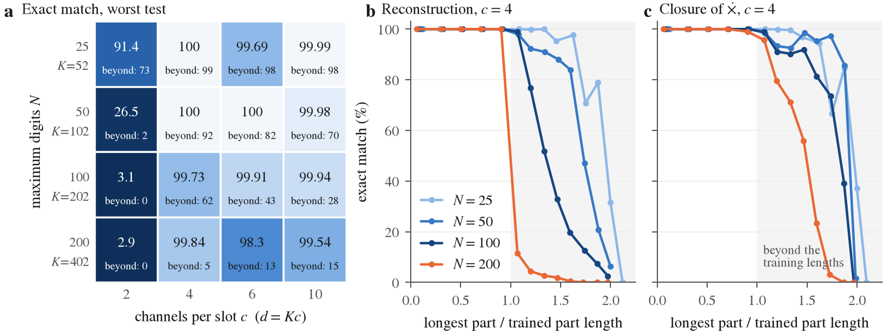
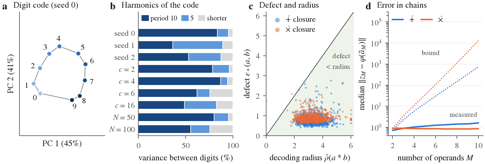

# paper

Scripts that build the tables, figures and text macros of the paper from the stored results. They need neither a GPU
nor the model weights.

```bash
python paper/make_tables.py      # Tables 4, A.2, A.3, A.4, A.5, Figure 6, numbers.tex, results/csv/
python paper/make_figures.py     # Figures 4, 5, 7, 8, 9, 10
```

`reading/make_table.py` (Table 6) and `downstream/make_tables.py` (Table 7, Figures 11, 12) write into the same
folder. `figstyle.py` holds the common figure style (STIX fonts, the text width of the journal template), and
`length_tables.py` builds Table A.4 and the macros of the length study.

## paper/generated

| File | Paper |
|:---|:---|
| `tab_main.tex` | Table 4 |
| `tab_reader.tex` | Table 6 |
| `tab_llm.tex` | Table 7 |
| `tab_abl_operator.tex` | Table A.2 |
| `tab_abl_full.tex` | Table A.3 |
| `tab_lengthdim.tex` | Table A.4 |
| `tab_geometry.tex` | Table A.5 |
| `fig_distributions.pdf` | Figure 4 |
| `fig_lengths.pdf` | Figure 5 |
| `fig_training.pdf` | Figure 6 |
| `fig_operators.pdf` | Figure 7 |
| `fig_profile.pdf` | Figure 8 |
| `fig_lengthdim.pdf` | Figure 9 |
| `fig_geometry.pdf` | Figure 10 |
| `fig_llm.pdf` | Figure 11 |
| `fig_llm_causal.pdf` | Figure 12 |
| `numbers.tex`, `reader_numbers.tex`, `llm_numbers.tex` | numbers quoted in the text, as `\newcommand` macros |

`png/` has PNG copies of the figures.

### Figure 6: validation exact match during training


### Figure 7: operators trained alone


### Figure 8: what each component of NIF is needed for


### Figure 9: number length and embedding dimension


### Figure 10: geometry of the trained embedding

